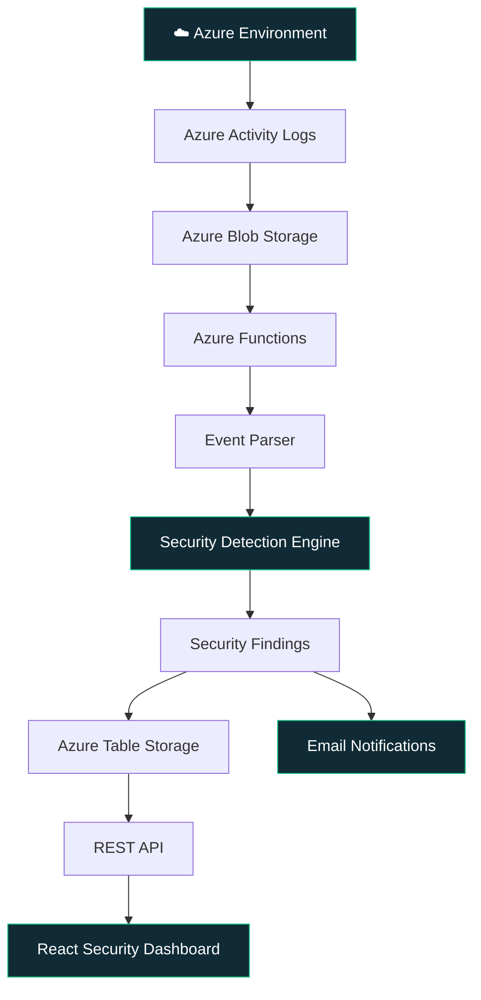

<div align="center">

# 🛡️ CLOUD SECURITY MONITOR

### Intelligent Cloud Security Monitoring & Threat Detection

**Monitor. Detect. Investigate. Secure.**

A centralized cloud security platform that analyzes activity logs, detects suspicious operations, and provides actionable security insights through an interactive dashboard.

<br/>


<br/>

**A smarter way to monitor your cloud security infrastructure.**

</div>

---

## ◈ Overview

Cloud Security Monitor (CSM) is an Azure-based cloud security monitoring platform designed to identify suspicious activities and potential security threats.

It processes Azure Activity Logs, applies predefined detection rules, generates security findings, and presents the results through a centralized monitoring dashboard.

Instead of manually reviewing cloud activity logs, security teams can use CSM to gain visibility into suspicious operations, investigate findings, monitor security events, and generate reports.

## ◈ Key Features

<table>
<tr>
<td width="50%">

### 🛡️ Security Dashboard

* Real-time backend connectivity status
* Security overview metrics
* Severity distribution
* Risky IP addresses
* Recent security activities

</td>
<td width="50%">

### 🔍 Threat Detection

* Automated security rule evaluation
* Suspicious login detection
* Critical configuration changes
* IAM and permission changes
* Security findings generation

</td>
</tr>
<tr>
<td width="50%">

### 📊 Findings & Reports

* Advanced search and filtering
* Finding investigation
* CSV export
* PDF report generation
* Paginated security findings

</td>
<td width="50%">

### ☁️ Azure Integration

* Azure Activity Log ingestion
* Azure Resource inventory
* Azure Functions integration
* Azure Table Storage
* Microsoft Entra ID authentication

</td>
</tr>
</table>

---

## ◈ How It Works

CSM follows an automated security monitoring pipeline.



### Processing Workflow

| Step | Process             | Description                                       |
| :--: | ------------------- | ------------------------------------------------- |
|  01  | Log Ingestion       | Collects exported cloud activity logs.            |
|  02  | Event Parsing       | Normalizes incoming security events.              |
|  03  | Threat Detection    | Evaluates events against security rules.          |
|  04  | Findings Generation | Creates findings for suspicious activities.       |
|  05  | Data Storage        | Stores findings in Azure Table Storage.           |
|  06  | Monitoring          | Displays security insights through the dashboard. |
|  07  | Notifications       | Sends configured severity-based email alerts.     |

---

## ◈ Security Detection Capabilities

The detection engine identifies potentially suspicious cloud operations using predefined security rules.

| Security Event                        |   Severity  |
| ------------------------------------- | :---------: |
| Root Account Activity                 | 🔴 Critical |
| Logging / Diagnostics Disabled        | 🔴 Critical |
| Public Storage Configuration Changes  |   🟠 High   |
| Security Group / Network Rule Changes |   🟠 High   |
| IAM / Role / Policy Modifications     |   🟠 High   |
| 5 or More Failed Login Attempts       |   🟠 High   |
| Successful Login From a New Region    |  🟡 Medium  |

**Detection Engine:** Python-based rule evaluation
**Implementation:** `backend/csm/rules.py`

---

## ◈ Technology Stack

<div align="center">

| Layer             | Technologies             |
| ----------------- | ------------------------ |
| Frontend          | React, TypeScript, Vite  |
| UI & Styling      | Tailwind CSS             |
| Authentication    | Microsoft Entra ID, MSAL |
| Backend           | Python, Azure Functions  |
| Log Ingestion     | Azure Blob Storage       |
| Database          | Azure Table Storage      |
| Cloud Integration | Azure Resource Manager   |
| Notifications     | Resend                   |
| Infrastructure    | Terraform                |

</div>

---

## ◈ Application Modules

| Module          | Functionality                            |
| --------------- | ---------------------------------------- |
| Authentication  | Microsoft Entra ID sign-in               |
| Dashboard       | Security metrics and threat overview     |
| Findings        | Search, filter, and investigate findings |
| Finding Details | Detailed security event information      |
| Alerts          | Email alert configuration                |
| Reports         | CSV and PDF report generation            |
| Resources       | Azure resource inventory                 |
| Settings        | API configuration and backend health     |

---

## ◈ Project Structure

```text
Cloud-Security-Monitor/
│
├── src/
│   ├── components/
│   │   └── auth/
│   │       └── ProtectedRoute.tsx
│   │
│   ├── hooks/
│   │   ├── useFindings.ts
│   │   └── useBackendHealth.ts
│   │
│   ├── pages/
│   │   ├── DashboardPage.tsx
│   │   ├── FindingsPage.tsx
│   │   ├── FindingDetailsPage.tsx
│   │   ├── AlertsPage.tsx
│   │   ├── ReportsPage.tsx
│   │   ├── ResourcesPage.tsx
│   │   ├── SettingsPage.tsx
│   │   └── LoginPage.tsx
│   │
│   ├── services/
│   │   └── securityService.ts
│   │
│   └── App.tsx
│
├── backend/
│   ├── csm/
│   │   ├── api.py
│   │   ├── auth.py
│   │   ├── emailer.py
│   │   ├── parser.py
│   │   ├── resources.py
│   │   ├── rules.py
│   │   └── store.py
│   │
│   ├── function_app.py
│   └── README.md
│
├── terraform/
│   └── main.tf
│
├── docs/
│   └── BACKEND_INTEGRATION.md
│
├── vite.config.js
├── package.json
└── README.md
```

---

## ◈ Getting Started

### Prerequisites

* Node.js and npm
* Python (for local backend development)
* Microsoft Azure account
* Microsoft Entra ID application registration
* Configured Azure resources

### 1. Clone Repository

```bash
git clone <repository-url>
cd "Cloud Security Monitor"
```

### 2. Install Dependencies

```bash
npm install
```

### 3. Configure Environment Variables

Create a `.env` file in the project root.

```env
VITE_API_BASE_URL=https://<your-function-app>.azurewebsites.net
```

Configure the remaining Microsoft Entra ID variables using the names expected by the application.

**Security Note:** Never expose client secrets, access tokens, or sensitive credentials in frontend environment variables.

### 4. Start Development Server

```bash
npm run dev
```

Application:

```text
http://localhost:5173
```

---

## ◈ Backend & Cloud Deployment

The backend is deployed on Microsoft Azure.

| Component        | Deployment          |
| ---------------- | ------------------- |
| Function App     | `csmfunc583`        |
| Backend Runtime  | Azure Functions     |
| Log Storage      | Azure Blob Storage  |
| Findings Storage | Azure Table Storage |
| Authentication   | Microsoft Entra ID  |
| Infrastructure   | Terraform           |

The frontend communicates with the deployed Function App through authenticated HTTPS API requests.

For backend configuration and local execution, refer to [`backend/README.md`](backend/README.md).

---

## ◈ API Reference

| Method | Endpoint               | Purpose                      |
| ------ | ---------------------- | ---------------------------- |
| GET    | `/api/findings`        | Retrieve and filter findings |
| GET    | `/api/findings/{id}`   | Retrieve finding details     |
| GET    | `/api/stats/overview`  | Dashboard statistics         |
| GET    | `/api/resources`       | Azure resource inventory     |
| GET    | `/api/alerts/settings` | Retrieve alert settings      |
| PUT    | `/api/alerts/settings` | Update alert settings        |

All protected API requests require valid Microsoft Entra ID authentication.

---

## ◈ Future Roadmap

Potential enhancements for future development:

* [ ] Machine learning-based anomaly detection
* [ ] Advanced threat intelligence integration
* [ ] Multi-cloud security monitoring
* [ ] Automated incident response
* [ ] Advanced threat correlation
* [ ] Real-time security analytics
* [ ] Role-based access control enhancements
* [ ] Security recommendations and remediation workflows

---

## ◈ Important Implementation Notes

* Detection currently uses predefined Python security rules, not a machine-learning model.
* Resource inventory does not represent complete live resource health monitoring.
* Finding status update functionality is not included in the documented API routes.
* Email recipients are controlled through backend configuration using `ALERT_TO_EMAIL`.
* Log monitoring depends on configured Azure Activity Log exports and backend processing.

---

<div align="center">

## 🛡️ Secure Your Cloud. Stay Ahead of Threats.

**CLOUD SECURITY MONITOR**

*Monitor cloud activity. Detect suspicious behavior. Gain security visibility.*

<br/>

Built with React, Python & Microsoft Azure.

</div>
